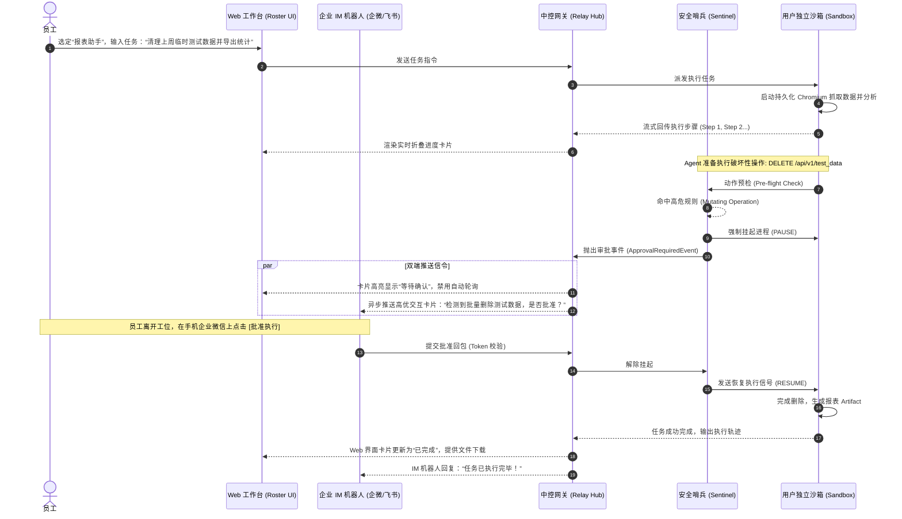

# MuseClaw 技术架构详细设计规范

本文档阐述 **MuseClaw** 的四层核心架构设计、核心数据流规范与生产级落地实践。

---

## 1. 核心架构四大分层详解

### 1.1 统一接入与展现层 (Access & Experience Layer)
* **Web 工作台 (Roster Mode)**:
  * 采用“通讯录/花名册”交互范式。主视图左侧为可配置的虚拟员工列表（如“数据分析专员”、“Jira巡检专员”、“内网合规审核员”）。
  * 每个 Bot 拥有专属的系统 Prompt、预加载工具集及关联沙箱的上下文。
  * 采用事件流驱动协议，前端直接消费流式事件包（`plan_step`、`tool_call`、`artifact_ready`、`require_approval`），无需轮询后端，支持卡片局部刷新与可交互表单。
* **企业 IM 网关 (Feishu / WeCom / DingTalk / Slack)**:
  * 提供轻量化的消息交互与高优先级事件下发通道。
  * 当 Web 端长任务在后台运行需要人工干预时，通过 IM 机器人主动触达员工。

### 1.2 中控与安全调度层 (Control & Relay Hub)
* **Session & State Relay（会话与状态中继）**:
  * 统一维护每个用户的全局状态机。
  * 无论用户从 Web 发起、还是从移动端企业微信发起，会话上下文均写入用户的集中事件流，杜绝多端状态分裂。
* **Sentinel 确定性安全哨兵引擎**:
  * **物理层拦截**：在沙箱宿主层建立拦截切面（如拦截不可逆的 HTTP POST/DELETE、破坏性 Shell 命令、未授权的外部调用）。
  * **挂起与求证状态机**：
    `NORMAL_RUNNING` -> `TRIGGER_MUTATION` -> `STATE_SUSPENDED` -> `DISPATCH_APPROVAL_REQUEST` -> `USER_CONFIRMED` -> `RESUME_EXECUTION`。
* **Skill Registry（技能注册中心）**:
  * **分层设计**：分为 `Global System Skills`（企业内网公共 API 封装）和 `User Private Skills`（个人沙箱挂载的私有工具）。

### 1.3 执行与沙箱层 (Sandbox Execution Layer)
* **单租户持久化沙箱 (Per-User Dedicated Sandbox)**:
  * 每个员工分配独立的轻量隔离容器（Docker / Podman / K8s Pod）。
* **持久化上下文与资源复用**:
  * **Chromium Profile 持久化**：员工登录一次内网系统（如 OA、Jira、GitLab），Cookie 与 LocalStorage 自动持久化保存在用户专属卷中，下次任务无需重复认证。
  * **工作空间持久化**：挂载 `/workspace` 目录，长期保留临时生成的报表、代码中间件与日志。

### 1.4 数据飞轮与自进化层 (Data & Learning Layer)
* **Trajectory Exporter (轨迹提取器)**:
  * 对沙箱内的完整会话链路进行结构化抽取。
  * 过滤敏感内网密码与个人隐私后，输出为通用的大模型微调对齐格式，直接用于后续私有小模型训练。
* **Skill Miner (技能自提炼)**:
  * 当 Agent 在沙箱里通过多轮探索成功解决了一个新问题，触发后置反思（Reflection）逻辑，生成封装好的独立脚本，经员工审核后存入 Skill Registry。

---

## 2. 核心工作流时序图 (Cross-Channel Sentinel Approval Flow)

---

## 3. 核心目录与代码模块规划

| 路径 | 核心职责 | 推荐技术栈 |
| :--- | :--- | :--- |
| `apps/gateway` | 集中式会话中继、多端 WebSocket 分发、IM Webhook 路由 | TypeScript / Node.js (Fastify / Hono) |
| `apps/sentinel` | 确定性权限策略校验、审批请求生命周期管理 | TypeScript (纯函数式规则引擎) |
| `apps/web` | 通讯录风格的前端控制台、卡片流式渲染 | React / Next.js / TailwindCSS |
| `packages/protocol` | 跨端通信数据模型（TypeScript Types / Zod Schema） | TypeScript (Zero-dependency) |
| `packages/sandbox-core` | 沙箱生命周期管理、CDP 浏览器控制与任务执行 | TypeScript / Node.js |
| `packages/skills-registry` | 全局技能与私有技能解析器、动态代码加载器 | Python / TypeScript |
