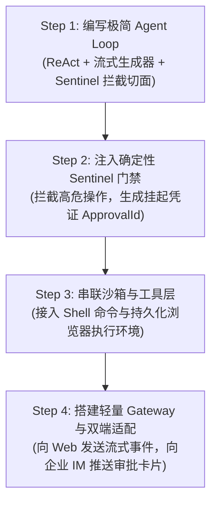

# MuseClaw “薄核”实现规划与工程路线

> **核心设计原则**：薄核自研（Thin-Core），聚焦核心状态机与高价值差异化能力，成熟外围组件模块化解耦，避免臃肿的历史包袱。

---

## 一、系统工程分层设计

| 模块名称 | 职责定位 | 核心设计规范 |
| :--- | :--- | :--- |
| **模型调用层** | 统一大模型流式调用与 Function Calling 转换 | 遵循 OpenAI / 标准 Chat Completions 协议，解耦具体模型供应商。 |
| **执行沙箱层** | 持久化浏览器与 Shell 执行环境 | 容器/子进程轻量隔离，提供独立的 Chromium 会话管理与 Linux 基础工具链。 |
| **安全审批门禁** | 确定性敏感动作拦截 (Sentinel) | 采用物理切面拦截不可逆操作，以 Promise 挂起状态机，实现跨端审批解挂。 |
| **前端交互范式** | 通讯录 (Roster) + 流式卡片 | 左侧多 Bot 角色面板，右侧结构化流式事件卡片（`plan`、`tool`、`approval`）。 |
| **数据飞轮** | 任务执行轨迹收集与微调沉淀 | 在 Agent 步骤末尾异步抓取执行链，任务完成后导出标准格式用于模型对齐训练。 |

---

## 二、薄核（Thin-Core）落地四步走

---

## 三、各阶段交付物与代码目录结构

1. **Phase 1: Agent 核心循环与 Sentinel 切面 (Core Loop)**
   * 文件：`packages/sandbox-core/src/loop.ts`（包含思考、工具拦截、执行、反思的最小状态机）。
   * 文件：`apps/sentinel/src/guard.ts`（确定性规则匹配器）。
2. **Phase 2: 统一事件总线与双端中继 (Relay Gateway)**
   * 文件：`apps/gateway/src/server.ts`（轻量 Web/WebSocket + IM Webhook 接收器）。
3. **Phase 3: 通讯录配置与技能加载 (Roster & Skills)**
   * 文件：`packages/skills-registry/src/loader.ts`（动态加载任务专属工具脚本）。
4. **Phase 4: 轨迹导出器 (Trajectory Exporter)**
   * 文件：`packages/sandbox-core/src/trajectory.ts`（生成用于微调的数据集）。
