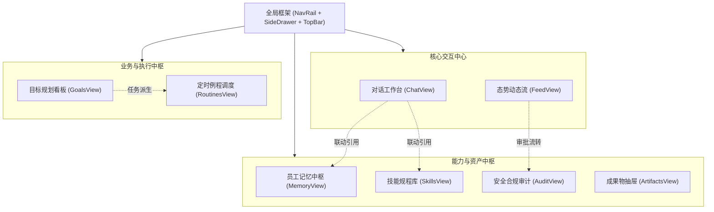

# MuseClaw 工作台全页面重构与精细打磨路线图

> 本规划依据已建立的 [PRODUCT.md](./PRODUCT.md) 与 [DESIGN.md](./DESIGN.md) 规范，围绕「视觉质感跃升」与「组件架构规范」双维度，对 MuseClaw Web 工作台全部 8 大视图、全局外框及全部模态进行系统性重构与打磨。

---

## 1. 架构与视图依赖全景

---

## 2. 模块重构与打磨进度清单

### 阶段一：全局外框与交互基座（Shell Frame）✅ 已完成 (Commit: `e05f609`)
- [x] **NavRail（左侧紧凑导航栏）**
  - 补充 Audit 快速导航、重塑激活指示胶囊与悬停微动效
  - 优化工作台状态徽标（Badge）与在线状态指示呼吸灯
  - 底部操作区（主题切换、设置、登录用户、状态指示）视觉对齐
- [x] **SideDrawer（二级上下文抽屉）**
  - 实时搜索过滤会话与新建会话按钮组
  - 内联双步确认删除防误触交互，全面移除破坏性原生 confirm 弹窗
  - 优化移动端/窄屏下的展开折叠抽屉动效与遮罩交互
- [x] **TopBar（全局顶栏）**
  - 强化当前工作区标题与快捷状态信息（当前运行模型、网关连通性）
  - 统一操作按钮组（操作日志抽屉、全局快速检索、全屏状态）

### 阶段二：核心交互中心（Chat & Feed）✅ 深度打磨完成 (Commit: `355346c`, `22eeae4`)
- [x] **ChatView（对话工作台）**
  - **MessageBubble**：区分用户指令气泡与智能体思考回复，优化 Markdown 排版、代码高亮与单条一键复制反馈
  - **ToolTrace**：重塑工具调用轨迹卡片，入参/出参一键独立复制、终端黑底与退出码高亮、执行耗时标签与状态指示
  - **AgentCapsule**：支持 Hero 大卡片与 Header 悬浮居中模式，具备思考中/调用工具等实时动态徽标
  - **ChatComposer**：重构底部输入区、快捷指令弹窗、附件拖拽区域与停止/发送控制
  - **ChatView 空态与骨架**：升级为包含 Agent 身份、角色与 4 宫格场景指引卡片（长周期目标、长期记忆、定时巡检、沙箱自检），以及载入会话时的波光骨架屏动效
- [x] **FeedView（全局态势流）**
  - **审批卡片（Approval Cards）**：高危/重要操作一键通过/驳回操作栏与状态倒计时
  - **时间线流（Activity Timeline）**：统一事件分类标签、时间聚合分组与直观会话下钻
  - **动态删除防误触**：单条删除引入非阻断两步内联确认（`.is-confirming` 配合 3.5s 自动重置）

### 阶段三：业务推进与规划中枢（Goals & Routines）✅ 深度打磨完成 (Commit: `7f6fc09`, `ebe2cf6`)
- [x] **GoalsView（长期目标看板）**
  - 全面消除内联样式，重构目标分类胶囊、提案横幅、卡片头部徽章、里程碑进度条、行内极速添加步骤及 4 大模态窗
  - 优化目标进度条与状态流（active, completed, paused, blocked）视觉标签
  - 非阻断两步内联删除确认与平滑过滤状态重置
- [x] **RoutinesView（例行任务中枢）**
  - 重构顶部指标栏（状态自适应色彩 `is-success`, `is-warning`, `is-muted`）、左侧搜索过滤 Tab、右侧调度详情网格与 Webhook 接口条
  - 执行流水记录卡片增加失败即刻重试（`重试` 按钮带运转微动效）与工具轨迹直接展开
  - 智能中文 Cron 周期识别与接下来 3 次运行时间预测预估预览面板

### 阶段四：知识记忆与合规资产（Memory, Audit & Artifacts）✅ 已完成 (Commit: `1e78f3c`)
- [x] **MemoryView（数字员工记忆中枢）**
  - 重构容量配额仪表盘、快速记录卡片、分类 Tab 筛选、记忆卡片列表（受保护/自动沉淀标签、复制/编辑/删除）、全文 Markdown 模态窗及整理预览 Dry-run 模态窗
- [x] **AuditView（安全合规审计中心）**
  - 消除内联样式，重构声明式策略卡片、Grants 活跃授权列表与操作审计流水表格
- [x] **ArtifactsView（成果物中心）**
  - 重构工件卡片网格、文件图标、下载/预览动作行及工件查看模态窗

### 阶段五：全局模态窗与智能体档案抽屉（Modals & Drawers）✅ 已完成 (Commit: `35d75e4`)
- [x] **AgentProfileDrawer**：数字员工形象配置、预设形象网格选择、Emoji 选择器与 SOUL 提示词编辑器
- [x] **ModelSettingsModal**：模型供应商网格、API Key、Base URL 端点、本地 Agent 探针检测与连通性测试
- [x] **AddMachineModal & AuthModal**：个人电脑伴侣接入命令一键复制、上线探针监听、登录/注册 Tab 切换与用户卡片
- [x] **通用模态窗基础**：统一定制动画出入场、阴影与无障碍键盘 Esc 监听

### 阶段六：全局微交互打磨与非阻断确认回归（Interactions Polish）✅ 已完成 (Commit: `089a10c`)
- [x] 全面消除 `GoalsView`、`RoutinesView`、`SkillsView`、`MemoryView` 遗留的阻断性原生 `confirm()`
- [x] 统一引入非阻断两步内联确认交互（`.is-confirming` 配合 3.5s 自动重置与呼吸边框动效）
- [x] 统一设计系统 CSS Tokens 与变量引用，无错位、无破坏性内联样式

---

## 3. 验收质量标准 (Definition of Done) 全部达标
1. **设计规范一致性**：完全遵守 [DESIGN.md](./DESIGN.md) 中的色彩层级、圆角阶梯、间距与排版规则。
2. **架构健康度与零内联样式**：所有视图组件全面消除内联对象样式，采用高内聚、易维护的语义化 CSS 规则。
3. **构建验证**：WSL 环境下 Vite 构建耗时约 330ms，0 错误、0 警告。
4. **Git 提交完整性**：每一个模块修改均具备独立、规范的 Git commit。
